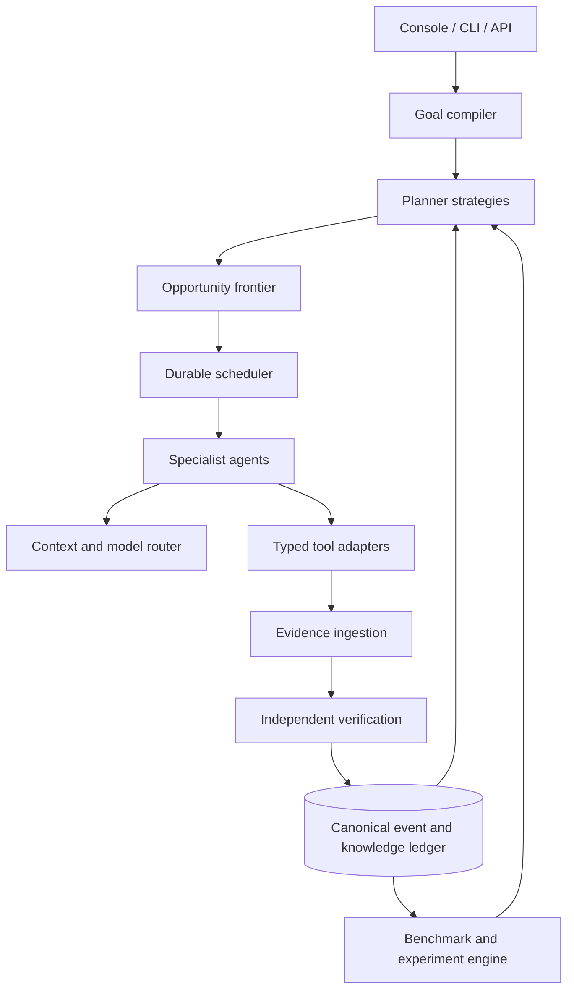

# System architecture

## Architectural planes
- **Intelligence:** goal compilation, graph-aware planners, frontier scoring, cognitive memory.
- **Control:** engagement lifecycle, scheduling, leases, checkpoints, budgets.
- **Execution:** replaceable specialist agent runtimes and typed tools.
- **Knowledge:** observations, assertions, verified facts, evidence artifacts, lineage.
- **Evaluation:** benchmark fixtures, run comparisons, planner tournaments.
- **Interface:** traces, agent status, findings, human review.

## Candidate stack (not final)
Go control plane, Python agent services, React/TypeScript UI, PostgreSQL, pgvector, S3-compatible evidence storage, Temporal candidates for durability, MCP adapters, OpenTelemetry.

## Invariants
Proposal != execution authorization. Observation != verified fact. The scheduler owns task lifecycle, the knowledge service owns provenance, verification owns finding disposition. Every task and model call records lineage. Failed workers cannot erase durable state. All contracts are versioned and tested.

## Decisions still needed
Workflow engine, event ordering, storage and graph projections, message schema, model router, work leasing, adapter API, migration policy.
